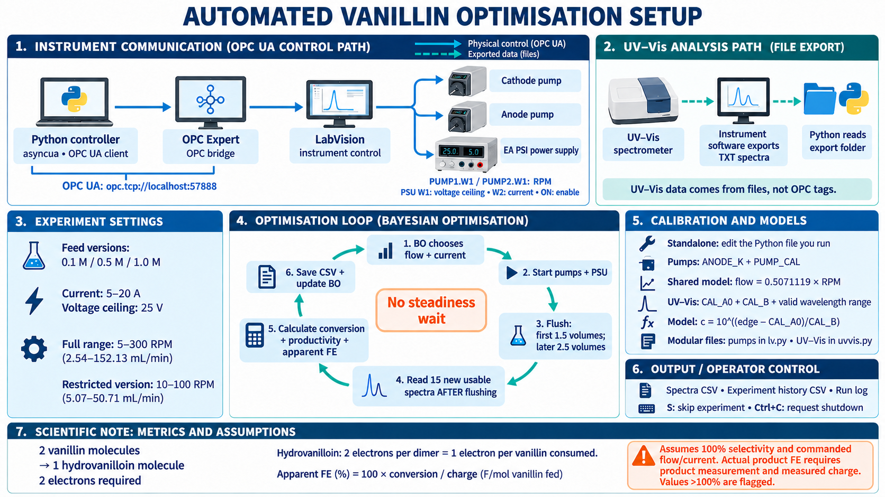

# HVN: vanillin electrolysis automation

Control two pumps and an EA PSI 9040-40 DT power supply, read exported UV–Vis spectra, and optimise vanillin conversion and consumption productivity with scikit-optimize.

**Use one standalone Python file for a campaign.** Download the current file from this repository to the lab PC; GitHub changes do not automatically update the local copy. Run only one controller at a time.

**New to this setup? Read the [simple setup and calibration guide](SETUP_GUIDE.md)** for equipment configuration, pump/UV–Vis calibration edits and a first run.

## Setup overview

[Open the full-size overview image](docs/images/vanillin_setup_overview.png).

## Choose a standalone version

Every standalone BO file includes pump/PSU control, calibration, UV–Vis parsing, BO, CSV logging, skip input, apparent hydrovanilloin FE and shutdown. No other local Python file or calibration workbook is required.

| Flow range (both pumps), mL/min | Feed, M | File |
|---|---:|---|
| Original: 2.86667–98.47333 | 0.5 | [vanillin_all_in_one.py](vanillin_all_in_one.py) |
| Original: 2.86667–98.47333 | 0.5 | [vanillin_all_in_one_0p5M.py](vanillin_all_in_one_0p5M.py) |
| Original: 2.86667–98.47333 | 1.0 | [vanillin_all_in_one_1M.py](vanillin_all_in_one_1M.py) |
| Low-flow: 2.87–13 | 0.5 | [vanillin_low_flow.py](vanillin_low_flow.py) |
| Low-flow: 2.87–13 | 0.5 | [vanillin_low_flow_0p5M.py](vanillin_low_flow_0p5M.py) |
| Low-flow: 2.87–13 | 1.0 | [vanillin_low_flow_1M.py](vanillin_low_flow_1M.py) |
| Full calibrated range: 2.53556–152.13357 | 0.5 | [vanillin_full_flow.py](vanillin_full_flow.py) |
| Full calibrated range: 2.53556–152.13357 | 0.1 | [vanillin_full_flow_0p1M.py](vanillin_full_flow_0p1M.py) |
| Full calibrated range: 2.53556–152.13357 | 0.5 | [vanillin_full_flow_0p5M.py](vanillin_full_flow_0p5M.py) |
| Full calibrated range: 2.53556–152.13357 | 1.0 | [vanillin_full_flow_1M.py](vanillin_full_flow_1M.py) |
| 10–100 RPM: 5.07112–50.71119 | 0.1 | [vanillin_10_100rpm_0p1M.py](vanillin_10_100rpm_0p1M.py) |
| 10–100 RPM: 5.07112–50.71119 | 0.5 | [vanillin_10_100rpm_0p5M.py](vanillin_10_100rpm_0p5M.py) |
| 10–100 RPM: 5.07112–50.71119 | 1.0 | [vanillin_10_100rpm_1M.py](vanillin_10_100rpm_1M.py) |

The original range retains the earlier flow bounds; it does not use the full calibrated pump range. Existing unsuffixed 0.5 M files are retained alongside explicitly named 0.5 M editions.

Changing feed concentration changes the conversion, derived charge and productivity calculations. It does not automatically change the UV–Vis calibration, NaOH concentration, current bounds or voltage ceiling.

## Installation

Use Python 3.10 or newer and install the packages from [requirements.txt](requirements.txt) into the interpreter that will run the experiment:

~~~powershell
python -m pip install --upgrade pip
python -m pip install -r requirements.txt
~~~

For the lab PC, use its explicit Python executable if VS Code selects a different interpreter:

~~~powershell
& "C:\Users\fen36728\AppData\Local\Python\pythoncore-3.14-64\python.exe" -m pip install -r "C:\Users\fen36728\Desktop\Python HVN Automation\requirements.txt"
~~~

The requirements list asyncua, NumPy, SciPy, scikit-learn and scikit-optimize. SciPy and scikit-learn support the optimiser; scikit-learn is also imported directly for warning handling. Standard-library modules, including csv, asyncio and threading, require no pip installation. openpyxl, pandas and Excel are not required to run the controller: it writes CSV, not XLSX.

Package availability depends on the Python version and platform. Installation and physical operation on the lab PC must be checked locally; the code checks reported here are offline checks.

## Start, preview, inspect spectra, and stop

These commands use the 10–100 RPM, 0.1 M version as an example. Substitute any standalone filename from the table.

**Preview only** — prints limits and the first proposed condition; no OPC connection or equipment writes:

~~~powershell
& "C:\Users\fen36728\AppData\Local\Python\pythoncore-3.14-64\python.exe" "C:\Users\fen36728\Desktop\Python HVN Automation\vanillin_10_100rpm_0p1M.py"
~~~

**Inspect the newest exported spectrum only** — no equipment operation:

~~~powershell
& "C:\Users\fen36728\AppData\Local\Python\pythoncore-3.14-64\python.exe" "C:\Users\fen36728\Desktop\Python HVN Automation\vanillin_10_100rpm_0p1M.py" --check-spectra
~~~

**Start the experiment:**

~~~powershell
& "C:\Users\fen36728\AppData\Local\Python\pythoncore-3.14-64\python.exe" "C:\Users\fen36728\Desktop\Python HVN Automation\vanillin_10_100rpm_0p1M.py" --live
~~~

**Stop the running campaign:** press Ctrl+C in its terminal. Cleanup requests PSU disable, current zero, voltage zero and both pump setpoints zero. Check the log and equipment for completion.

**Separate stop command**, after the controller has exited:

~~~powershell
& "C:\Users\fen36728\AppData\Local\Python\pythoncore-3.14-64\python.exe" "C:\Users\fen36728\Desktop\Python HVN Automation\vanillin_10_100rpm_0p1M.py" --stop
~~~

A separate stop command does not terminate another controller process; an active controller could issue later commands. End the running campaign first.

Optional voltage ceiling override:

~~~powershell
python vanillin_10_100rpm_0p1M.py --live --voltage-limit 20
~~~

The ceiling must be greater than zero and at most 25 V. The --voltage alias is also supported. Mode flags --live, --stop and --check-spectra are mutually exclusive. The CLI sets dry-run mode; editing the top-level DRY_RUN literal is not a substitute for --live.

## Skip an experiment

With the running terminal focused, press **S** on Windows. On other systems, type **S then Enter**. Lowercase s is accepted.

- Requests are checked during flushing and measurement. Device writes already in progress finish before the next check.
- A skipped attempt does not train BO and adds no accepted-history row. Spectra already logged remain in the spectra CSV.
- The next condition differs from previously skipped points. If skopt repeats a skipped proposal, the controller samples a different in-range condition without inventing an experimental score.
- The next started condition receives the usual 2.5-volume flush.
- Skips count toward the campaign attempt limit. A skip on the last attempt ends the campaign.
- Requests between experiments are ignored. Keyboard input requires an interactive terminal.

Ctrl+C still stops the entire campaign.

## Campaign sequence and settings

| Setting | Default |
|---|---|
| Current setpoint range | 5–20 A |
| Voltage ceiling | 25 V |
| Electrode area | 100 cm² |
| NaOH concentration | 1.5 M |
| Feed vanillin | Selected by file: 0.1, 0.5 or 1.0 M |
| Cathode transport volume | 70 mL |
| First experiment wait | 1.5 volumes = 105 mL |
| Later experiment flush | 2.5 volumes = 175 mL |
| Measurement | First 15 usable post-flush spectra |
| Steadiness requirement | None |
| Measurement timeout | 600 s after flushing |
| Poll interval | 2 s |
| Progress interval | 15 s |
| Campaign plan | 6 initial LHS points, then 14 BO attempts |
| Maximum campaign duration | 14 h |
| Consecutive failed measurements before stopping | 3 |
| Random seed | 1 |

1. Validate settings and, in live mode, require both pump setpoints to be near zero.
2. BO proposes flow and current; there is no forced 10 mL/min or 5 A first condition.
3. Prepare voltage/current setpoints, then issue both pump setpoints and PSU-enable writes concurrently. There is no deliberate ramp wait; physical simultaneous actuation is not guaranteed.
4. Wait the transported volume. Python does not read spectrum files during flushing.
5. After flushing, ignore files timestamped before flush completion and collect 15 new usable spectra.
6. Average their conversions, calculate consumption productivity and apparent HVN FE, save the result, and tell BO the negative objective.
7. Apply the next condition and repeat. Shutdown is requested at completion, interruption, campaign timeout or error.

Flush duration is volumes × 70 / flow_mL_min × 60 seconds, starting after the setpoint commands complete. A new campaign, including a resumed campaign, starts with 1.5 volumes. Each subsequent started condition uses 2.5 volumes.

A failed measurement supplies no invented score to BO. Without a new observation, a normal failed attempt can repeat the same proposal; operator-skipped points are explicitly avoided. The 20-attempt plan does not guarantee 20 accepted results.

## How Python communicates with LabVision

This setup uses **OPC Expert as the bridge between Python and the LabVision control system**.

~~~text
Python controller (asyncua OPC UA client)
        |
        | OPC UA reads/writes
        v
OPC Expert bridge / OPC UA endpoint
        |
        | configured OPC connection to LabVision's instrument tags
        v
LabVision control system
        |
        v
Pumps and power supply
~~~

Python uses the **asyncua** package to connect to the OPC UA endpoint exposed for this setup:

~~~text
opc.tcp://localhost:57888
~~~

The configured item prefix is:

~~~text
Hitec_OPC_DA20_Server->HVN:
~~~

For example, the full cathode pump setpoint NodeId is:

~~~text
ns=3;s=Hitec_OPC_DA20_Server->HVN:PUMP1.W1
~~~

Python writes pump RPM, current, voltage-limit and enable/disable commands to these OPC nodes; the configured OPC Expert/LabVision connection passes the commands to the equipment. Python is not directly controlling the pumps through a serial cable or the PSU through a vendor driver in this implementation.

In OPC Expert, the LabVision OPC connection and the required items must be available to the OPC UA endpoint used by Python. The item names retain the source server name Hitec_OPC_DA20_Server. Use the actual bridge/source configuration on your own installation; the scripts do not create or configure OPC Expert or LabVision.

**localhost means the computer running Python.** If OPC Expert's endpoint is on another PC, set OPC_URL (or URL in lv.py) to that PC's reachable OPC UA endpoint. Your own namespace index, prefix and item names may differ; browse them in OPC Expert and update node() and the tag settings accordingly. The existing code uses namespace index 3 and a connection without explicit username/certificate configuration; a server requiring authentication/security needs matching client configuration.

The communication path and the analysis path are separate: **UV–Vis spectra are read from instrument-exported TXT files**, not streamed through these OPC tags.

## Pump calibration and PSU configuration

Standalone BO versions use the user-requested anode water calibration for **both pumps**:

~~~text
flow_mL_min = 0.5071118969420833 × RPM
RPM = flow_mL_min / 0.5071118969420833
~~~

Both pumps receive the same RPM for a selected flow. Full-range editions use 5–300 RPM; 10–100 RPM editions enforce that narrower range. Original and low-flow editions apply additional flow bounds.

The calibration was measured with water. Commanded flow is not verified by an actual-flow measurement during a campaign.

| Configuration | Value |
|---|---|
| OPC UA endpoint | opc.tcp://localhost:57888 |
| Node prefix | ns=3;s=Hitec_OPC_DA20_Server->HVN: |
| Cathode pump RPM setpoint | PUMP1.W1 |
| Anode pump RPM setpoint | PUMP2.W1 |
| PSU voltage ceiling setpoint | POWERSUPPLY.W1 |
| PSU current setpoint | POWERSUPPLY.W2 |
| PSU enable/disable command | POWERSUPPLY.ON |

The EA PSI supply regulates current subject to its voltage/power limits and the load. A commanded current is not proof that the current was achieved. The 25 V software ceiling limits commands; the script does not configure independent hardware OVP.

Per the requested setpoint-only workflow, pump actual-RPM reads, actual-voltage reads and PSU on/off status checks are absent. Pump setpoints are still read at preflight. OPC communication failures and incomplete shutdown writes are still reported. Fractional RPM commands require compatible floating-point OPC node types; the code rejects integer-only nodes rather than silently truncating.

## UV–Vis exports and concentration

The instrument software must acquire and export spectra. **Python does not trigger acquisition.**

Default settings:

~~~python
SPECTRA_FOLDER = r"C:\Users\fen36728\Desktop\UV VIS"
SPECTRA_GLOB = "*OnlineUVVisHVN*.txt"
~~~

Supported BO exports contain 2048 valid wavelength/absorbance rows. Headers are skipped; UTF-8 BOM, decimal commas and descending axes are handled. The resulting axis must be strictly increasing and values finite. A file must be at least 0.5 s old before processing; incomplete/invalid files are retried. Each spectrum needs a distinct filename. Modification timestamps determine the condition assignment.

The default analysis tracks the falling absorbance edge at A = 0.75 with smoothing:

~~~text
concentration_M = 10 ** ((edge_nm - 430.03839) / 19.12081)
conversion = 1 - concentration_M / feed_M
~~~

The BO conversion is limited to 0–1 and uses a concentration floor of 0.0005 M. Consequently the floor-limited maximum conversion is 99.5% at 0.1 M, 99.9% at 0.5 M, and 99.95% at 1.0 M. A plateau at those values is not independent proof of complete reaction.

Statuses calibrated and extrapolated can contribute to the measurement. Estimates below the approximately 0.02 M lowest calibration standard are extrapolations. Missing/unresolved edges, saturation and malformed spectra are not treated as full conversion. Existing calibration coefficients are retained across feed versions; changing the feed does not validate the calibration in a different matrix.

## BO objective, charge and productivity

The optimiser is skopt.Optimizer with a Gaussian process, Latin-hypercube initial design, expected improvement and sampling-based acquisition optimisation. It minimises, so the controller supplies the negative experimental score.

The independent search dimensions are flow and current. Charge is derived, with no separate charge constraint:

~~~text
F = 96485.33 C/mol
charge_F_mol = current_A × 60000 / (F × feed_M × flow_mL_min)
productivity_mmol_h = conversion × feed_M × flow_mL_min × 60
~~~

Productivity means **vanillin consumed**, not measured hydrovanilloin production. Under assumed 100% hydrovanilloin selectivity, the molar hydrovanilloin production rate would be half the vanillin-consumption rate.

The default weighted score is:

~~~text
J = 0.5 × conversion + 0.5 × productivity / (feed_M × upper_flow_bound × 60)
~~~

The optional constrained objective applies a soft penalty below 95% conversion; it does not guarantee the target. Score normalisation depends on the file's flow bounds, so objectives from different flow families are not directly comparable. The objective is not Faradaic efficiency.

To resume, set RESUME_CSV in the selected script to compatible accepted history. Its flow/current observations must lie inside the new bounds. Use the same feed, calibration and objective conditions; those compatibility details are not automatically verified by the resume loader.

## Apparent hydrovanilloin Faradaic efficiency

**Two electrons form one hydrovanilloin molecule from two vanillin molecules.** This equals one electron per vanillin molecule consumed.

The files calculate:

~~~text
apparent_hvn_FE_percent = 100 × conversion / charge_F_mol
~~~

The charge denominator is F per mole of vanillin fed. This estimate assumes all consumed vanillin forms hydrovanilloin and uses commanded current/flow. It is **not measured product FE**.

Actual product FE requires independently measured hydrovanilloin production and charge:

~~~text
FE_percent = 100 × 2 × F × moles_hydrovanilloin / measured_charge_C
~~~

At assumed 100% selectivity, moles_hydrovanilloin = moles_vanillin_fed × conversion / 2. This cancels the factor 2 when using the vanillin-based conversion formula. Independently measured selectivity on a consumed-vanillin basis can be multiplied by the apparent estimate to account for product selectivity.

CSV outputs include apparent_hvn_FE_percent and apparent_hvn_FE_above_100. Values above 100% remain visible and trigger a terminal warning for accepted BO results; they do not alter conversion, reject measurements or change the BO objective. Check concentration calibration, actual flow/current, carryover and non-product vanillin disappearance. The legacy faradaic_eff_not_measured column remains blank.

## CSV files and logs

Results are saved beside the selected script. The scripts write **CSV files that Excel can open**, not native XLSX workbooks.

| Output | Content |
|---|---|
| ...bo_spectra_TIMESTAMP.csv | Post-flush spectrum filename, status, edge, concentration, conversion, condition, voltage setpoint and apparent FE |
| ...bo_history_TIMESTAMP.csv | One row per accepted experiment; mean conversion, conversion standard deviation, consumed-vanillin productivity, objective and apparent FE |
| ...run_TIMESTAMP.log | Commands/progress, warnings, skips and shutdown messages |

New concentration-specific editions use filename-specific CSV prefixes. Earlier editions retain their existing prefixes, such as full_flow_0p1M_bo_history_TIMESTAMP.csv. Modular BO logs are created by run_all.setup_logging and retain its run_TIMESTAMP.log naming.

The spectra CSV header is flushed when created and each spectrum row is flushed. The history header may remain buffered until the first accepted experiment, so it may appear as 0 KB while waiting. History rows are flushed after each accepted result. The steady column is blank because no steadiness test is performed; conversion_std is diagnostic only. Skipped and failed attempts have no accepted-history row. Existing CSV files are never retroactively changed by a script update.

## Other repository files and modular workflow

| File | Purpose |
|---|---|
| bo_loop.py | Modular BO, 0.5 M feed |
| bo_loop_0p5M.py | Explicitly named modular BO, 0.5 M |
| bo_loop_1M.py | Modular BO, 1.0 M |
| lv.py | Shared OPC tags, pump calibration and low-level writes for modular/fixed workflows |
| uvvis.py | Shared spectrum parser and concentration calibration |
| run_all.py | Shared connection/start/shutdown helpers; also an optional fixed-condition runner |
| stop.py | Modular shutdown entry point |
| requirements.txt | Python packages for all runtime versions |

Modular BO requires lv.py, uvvis.py and run_all.py in the same folder:

~~~powershell
python bo_loop_1M.py
python bo_loop_1M.py --check-spectra
python bo_loop_1M.py --live
python bo_loop_1M.py --stop
~~~

The modular BO controllers also support S-to-skip, 15 usable spectra after flushing, and apparent FE. Their pump conversion comes from lv.py.

The shared lv.py now uses the same linear anode calibration for both pumps, with 5–300 RPM limits. Modular BO retains its configured flow bounds of 2.86667–98.47333 mL/min.

The optional run_all.py command runs a fixed condition, not BO. Its current defaults are 5 mL/min, 5 A, and 0.5 M. It waits its configured transport delay after startup commands complete before reading new spectrum files. It does not implement the BO 15-spectrum/next-condition sequence or S-to-skip. It logs per-spectrum apparent FE. Use a BO edition for automatic experiment-to-experiment optimisation.

Editing run_all.py or lv.py does not change embedded settings in standalone files. Editing a standalone file does not update the modular helpers.

## Troubleshooting

| Symptom | Check |
|---|---|
| CommandNotFoundException | Invoke Python with the full quoted script path; do not type the bare filename from the VS Code installation folder. |
| ImportError for Reals | The correct import is from skopt.space import Real. Download the current script. |
| Missing module or yellow import underline | Install requirements using the same interpreter selected in VS Code. |
| DRY RUN: nothing was started | Add --live to the command. |
| Flushing countdown but no spectra | Expected in BO versions: reading is paused until flushing ends. |
| No matching spectra after flushing | Check export folder, TXT format, filename pattern and whether the instrument software is saving. |
| Spectrum count stays below 15 | Invalid/unusable or old files do not count. Check status, acquisition interval and timestamps. |
| Standard deviation is high | It is reported only; the first 15 usable post-flush spectra still complete the measurement. |
| History CSV is 0 KB | It may be buffered until the first accepted result. Spectra CSV should already have its header. |
| Same condition repeats after failure | No observation was supplied to BO; use S during an active attempt to skip and select a different condition. |
| Apparent FE above 100% | Investigate measurement/transport/command accuracy; do not interpret it as validated product efficiency. |
| PSU does not reach requested current | Actual regulation depends on load and voltage/power limits; actual current is not read by this workflow. |

## Verification limits

Offline checks covered syntax, pump bounds and conversions, concentration-dependent charge/conversion calculations, apparent FE electron stoichiometry, preservation of values above 100%, CSV columns, post-flush reading gates, 15-spectrum acceptance and skipping during flushing/measurement.

Physical pump delivery, achieved current, voltage, calibration in the experimental matrix, product selectivity and end-to-end lab operation have not been validated by those checks.

## Example experimental results

Uploaded experimental history files are stored unchanged in [results/](results/):

| Dataset | Feed | Accepted experiments | File |
|---|---|---:|---|
| 10–100 RPM campaign, 28 October 2026 | 0.1 M | 8 | [CSV history](results/rpm10_100_0p1M_bo_history_20261028_124154.csv) |
| Full-flow campaign, 28 October 2026 | 0.1 M | 20 | [Excel history](results/full_flow_0p1M_bo_history_20261028_103346.csv.xlsx) |

These historical files predate the apparent FE output columns. They are original experimental records, not independently validated product yields or measured Faradaic efficiencies. Their presence does not establish hardware or analytical validation. See the [results notes](results/README.md).
